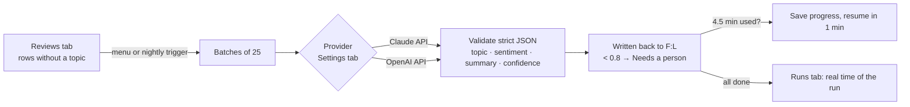

# AI Review Classifier (Google Sheets + Apps Script + Claude or OpenAI)

An Apps Script workflow inside a Google Sheet: new customer reviews are sent to an AI API in batches of 25 with a fixed prompt, and the **topic**, **sentiment**, a **one-line summary** and a **confidence** score are written straight back next to each review. Rows under 80% confidence are flagged for a person.

The demo uses **1,000 fictitious reviews** generated by the script (`DemoData.gs`), including a few deliberately ambiguous ones.



## How it works

| Part | File | Details |
| --- | --- | --- |
| Prompt and schema | `Classify.gs` | A fixed system prompt (the review text is treated as data, not instructions) and one JSON schema with enums for topic and sentiment. |
| Claude | `Classify.gs` | `POST /v1/messages`, model `claude-opus-5-5` by default, **structured outputs** (`output_config.format` with the JSON schema), `effort: low` for a classification task, and `fallbacks: "default"` so a request the model declines is re-run on Anthropic's recommended fallback model. |
| OpenAI | `Classify.gs` | Chat Completions with `response_format: json_schema` (`strict: true`). Set the model name in Settings. |
| Validation | `Classify.gs` | Every result must match a review ID, use a known topic and sentiment, and have a confidence from 0 to 1. Anything else (refusal, cut-off answer, bad JSON, missing review) becomes an **ERROR** row with the reason, never a silent skip. 429 / 5xx responses are retried up to 3 times with backoff. |
| Long runs | `Runner.gs` | Apps Script stops an execution after 6 minutes. The script stops starting new batches after 4.5 minutes, saves the run's counters in Script Properties and creates a one-off trigger that resumes a minute later, until every row is tagged. Progress is the sheet itself: a row is done once its topic is filled. |
| Timing | `Runner.gs` | When a run finishes, the **Runs** tab gets one row: start, finish, provider, model, reviews tagged, errors, API calls, wall-clock seconds, script seconds and number of executions. These are real measurements of that run. |
| Hand check | `HandCheck.gs` | Picks **300 random tagged reviews** into a Hand check tab with empty *Your topic* / *Your sentiment* dropdowns. The AI's answers are in hidden columns so you classify blind. *Compute hand-check agreement* then reports topic, sentiment and both-agree percentages. |
| Keys | `Setup.gs` | *AI tagging → Set API key…* saves the key in **Script Properties**. It is never in the code or in the sheet. |

## Install (about 10 minutes)

1. **Create a new, empty Google Sheet** (sheets.new).
2. *Extensions → Apps Script*. In *Project Settings*, tick **Show "appsscript.json" manifest file in editor**.
3. Replace `appsscript.json` with [`src/appsscript.json`](src/appsscript.json). Delete the default `Code.gs` and add script files `Config`, `Classify`, `Runner`, `HandCheck`, `DemoData`, `Setup` with the content from `src/`.
4. Select **`setupDemo`** and click **Run**; authorize the script (your own script: *Advanced → Go to …*). It creates the Reviews (1,000 fictitious reviews), Runs and Settings tabs, the menu and the nightly trigger (2am).
5. Reload the sheet. **AI tagging → Set API key…** and paste your Anthropic key (or set *Provider* to `OpenAI` and the *OpenAI model* first, then paste an OpenAI key).
6. **AI tagging → Tag new reviews.** The first part runs for up to 4.5 minutes; the rest continues by itself. Watch the columns fill in; the Runs tab gets a row when everything is tagged.

Costs are billed by the provider for every request. Try a smaller demo first with `setupDemo(100)` (run it from the editor after editing the call, or delete rows in the Reviews tab).

## Measuring it honestly

- **Time:** read it from the **Runs** tab after a full run. Nothing else in this repo states a time.
- **Accuracy:** after tagging, run **Create hand check**, fill in the 300 rows yourself without looking at the AI's columns, then **Compute hand-check agreement**. Only that number should be quoted.

## Tests

```bash
node --test tests/*.test.mjs
```

11 tests: settings validation; the Claude request (headers, model, structured output schema, fallbacks, key not in the body) and the OpenAI request; parsing success, refusal, cut-off answers, bad JSON and HTTP errors for both providers; result validation and the low-confidence flag; the time-sliced loop stopping before the deadline; hand-check agreement; deterministic sampling; and the demo data.

Not covered by the tests (needs a Google account and an API key): the real API calls, triggers and the resume trigger. Those are steps 4–6 above.
