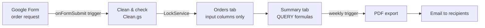

# Form-to-Sheet Automation (Google Apps Script)

Google Form responses are cleaned and written into a **formatted** Google Sheet without breaking formulas, dropdowns or conditional formatting. A summary tab is driven by formulas, and every week the summary is exported as a **PDF** and emailed.

Everything here is a demo with **fictitious data**: a made-up product catalog and fictitious orders generated by the script.



## What it does

| Part | File | Details |
| --- | --- | --- |
| Cleanup | `Clean.gs` | Trims text, title-cases names, lowercases emails, formats US phones as `(555) 123-4567`, reads dates like `2026-10-21`, `10/21/26` or `Oct 21, 2026`, matches the product to the catalog's spelling, reads `"3 units"` as `3`. Anything it can't fix is still written, with a note on the Order ID cell (e.g. *Check: Unknown product*). |
| Writing | `Orders.gs` | An installable `onFormSubmit` trigger on the form. Holds a script lock (`LockService`) so two simultaneous submissions never get the same row or order ID. Writes **only the input columns** (A:G and J:L); the formula columns H (unit price), I (total) and M (week) are single `ARRAYFORMULA`s in row 1 that the script never touches. New rows inherit the column's dropdowns and conditional formatting. |
| Summary | `Setup.gs` | `QUERY` formulas: totals per week (last 8), per product and per status. Cancelled orders are left out of the totals. |
| Weekly PDF | `Report.gs` | A time-driven trigger exports the Summary tab as a PDF and emails it. |
| Settings | Settings tab | Recipients, report day, report hour and email subject. Change them and run **Orders automation → Apply settings**; no code changes. |
| Demo data | `Setup.gs` | **Add 12 fictitious orders** sends deterministic, deliberately messy answers through the same pipeline a real response uses. |

The form is **not** linked to the sheet with Google's default "link to sheet" option, on purpose: that option dumps raw rows into a new tab. The trigger writes to the formatted table instead.

## Install (about 10 minutes)

You need a Google account. Nothing to install on your computer.

1. **Create a new, empty Google Sheet** (sheets.new).
2. **Open the script editor:** *Extensions → Apps Script*.
3. **Show the manifest:** click the gear (*Project Settings*) and tick **Show "appsscript.json" manifest file in editor**.
4. **Copy the files.** In the editor:
   - replace the content of `appsscript.json` with [`src/appsscript.json`](src/appsscript.json) (change `timeZone` if you want);
   - delete the default `Code.gs`;
   - add five script files with the **+** button → *Script* and paste each one: `Config`, `Clean`, `Orders`, `Report`, `Setup` (from `src/`).
5. **Run the setup.** Select `setupDemo` in the function dropdown and click **Run**. Google will ask you to authorize the script (it is your own script, so on the *"Google hasn't verified this app"* screen choose *Advanced → Go to …*). It needs these permissions:
   - Sheets and Forms: create the tabs and the order form;
   - Drive (read only): export the Summary tab as PDF;
   - send email as you, and manage triggers.
6. **Back in the sheet** (reload it), you have four tabs: **Orders**, **Summary**, **Products**, **Settings**, a menu **Orders automation**, and an order form. The form links are at the bottom of the Settings tab and in the execution log.
7. **Try it:**
   - open the form link, send an order, and watch the row appear in **Orders** (a few seconds);
   - or use **Orders automation → Add 12 fictitious orders**;
   - then **Orders automation → Send the weekly report now** to receive the PDF.

### Optional: clasp

If you use [clasp](https://github.com/google/clasp): `clasp create --type sheets --rootDir src`, then `clasp push`, open the sheet and run `setupDemo`.

## Tests

The cleanup and writing logic runs in Node with small fakes for the Google services (no Google account needed):

```bash
node --test tests/*.test.mjs
```

They cover each cleanup rule, the "only input columns are written" rule, order IDs after gaps, adding rows when the table is full, problem notes, and the lock being released even when a write fails.

What the tests can't cover (needs a real Google account): the trigger firing on a real form submission, the PDF export and the email. Those are the steps in *Try it* above.

## Change it

- **Products and prices:** edit the Products tab (and the form's Product question).
- **Columns:** `CONFIG.HEADERS` and `CONFIG.INPUT_BLOCKS` in `Config.gs`; add a matching question title to `CONFIG.QUESTIONS`.
- **Schedule and recipients:** the Settings tab, then *Apply settings*.
