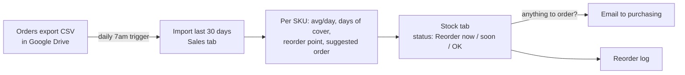

# Low-Stock Alerts (Google Sheets + Apps Script)

A Google Sheet that imports the last 30 days of sales from a store's orders export, works out how many days of stock each product has left, and every morning emails purchasing the products to reorder.

Everything here is a demo with **fictitious data**: a made-up home-goods catalog and 35 days of generated orders.



## The rules

Per SKU, with the defaults from the Settings tab:

| Number | Formula |
| --- | --- |
| Avg. sold / day | units sold in the last 30 days ÷ 30 (refunded and voided orders don't count; today is excluded) |
| Days of cover | on hand ÷ avg. sold per day |
| Reorder point | avg. per day × (supplier lead time + 7-day safety buffer), rounded up |
| **● Reorder now** | days of cover < lead time + 7 days |
| **▲ Reorder soon** | days of cover < lead time + 7 days + 7 more days |
| **✓ OK** | otherwise |
| Suggested order | avg. per day × (lead time + 45 days) − on hand, rounded up; only for *now* and *soon* |

Each status is shown with an icon and a label in the cell, plus a colour, so it doesn't rely on colour alone.

## Tabs

| Tab | What it holds |
| --- | --- |
| **Stock** | Yellow columns A:E are yours: SKU, product, supplier, lead time, on hand. Columns F:L are recalculated by the script on every check. |
| **Sales (last 30 days)** | The imported line items, replaced on each import. |
| **Reorder log** | One row per product flagged on each check: status, on hand, days of cover, suggested order and who was emailed. |
| **Settings** | Recipients, safety buffer, "soon" window, days an order should cover, sales window, check hour, and the Drive ID of the sales CSV. |

## Install (about 10 minutes)

1. **Create a new, empty Google Sheet** (sheets.new).
2. *Extensions → Apps Script*. In *Project Settings*, tick **Show "appsscript.json" manifest file in editor**.
3. Replace `appsscript.json` with [`src/appsscript.json`](src/appsscript.json). Delete the default `Code.gs` and add script files `Config`, `Stock`, `Alerts`, `DemoData`, `Setup` with the content from `src/`.
4. Select **`setupDemo`** and click **Run**. Authorize the script (your own script: *Advanced → Go to …*). It needs Sheets, Drive (to create and read the CSV), sending email as you, and triggers.
5. Setup creates `demo-store-orders-export.csv` in your Drive, builds the four tabs, imports the sales, calculates every SKU and installs the daily trigger at 7am (the spreadsheet's time zone).
6. Reload the sheet and use **Stock alerts → Run the daily check now** to get the email right away.

### With your own store

- Export orders from Shopify (*Orders → Export → CSV*), upload the file to Drive and put its ID (or link) in *Settings › Sales CSV*. Other platforms work if the CSV has columns named like `CONFIG.CSV_COLUMNS` in `Config.gs` (change the names there to match).
- Replace the Stock tab rows (A:E) with your products and lead times.
- After changing the check hour, run **Stock alerts → Apply settings**.

## Demo data

`DemoData.gs` generates the catalog and orders (deterministic: same seed, same data). The same generator writes local CSV files:

```bash
node scripts/make-demo-csv.mjs --today=2026-10-14
```

→ `demo-data/orders-export.csv` (Shopify export layout, order fields only on the first line item, about 3% refunded) and `demo-data/stock.csv`. The stock levels are chosen so the demo shows every status.

## Tests

```bash
node --test tests/*.test.mjs
```

They cover each status and its boundaries, the suggested order, products with no sales, CSV parsing (Shopify's blank order fields on extra line items, refunds, bad rows, missing columns), the 30-day window, settings validation, the email content, and that the demo data shows every status.

Not covered by the tests (needs a Google account): the trigger, the Drive import and the email itself. Those are steps 4–6 above.
