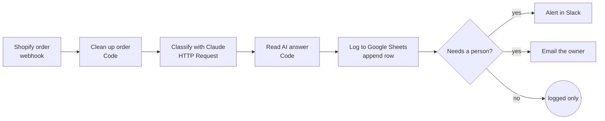

# Shopify → Sheets → AI → Alerts (n8n)

An n8n workflow for a Shopify store. Every new order is:

1. received from a **Shopify webhook** (`orders/create`),
2. cleaned into a simple record (customer, items, totals, shipping, past orders),
3. classified by **AI (Claude API)** for fraud **risk**, shipping **priority** and **customer type**, with a one-line reason,
4. logged as a row in **Google Sheets**,
5. and, only when it needs a person (high risk, rush or VIP), posted to **Slack** and emailed with **Gmail**.



## Files

| File | What it is |
| --- | --- |
| `workflow.json` | The workflow, ready to import into n8n |
| `test-orders/*.json` | Three sample orders in Shopify's webhook format: a normal order, a high-risk one and a VIP rush order |
| `send-test-orders.mjs` | Posts the sample orders to the webhook, like Shopify would |

## Setup (about 15 minutes)

1. **Import.** In n8n: *Workflows → Import from file* → `workflow.json`.
2. **Google Sheet.** Create a sheet with a tab named `Orders` and this header row:
   `Order · Created · Customer · Email · Total · Currency · Items · Ship to · Risk (AI) · Priority (AI) · Customer (AI) · Reason (AI) · Needs a person · Admin link`
   Paste the sheet's URL into the **Log to Google Sheets** node.
3. **Credentials.** Open each node with a warning and pick or create a credential:
   - **Classify with Claude**: *Header Auth*, name `x-api-key`, value = your Anthropic API key.
   - **Log to Google Sheets**: Google Sheets OAuth2.
   - **Alert in Slack**: a Slack app or bot token that can post to `#orders-alerts` (change the channel in the node).
   - **Email the owner**: Gmail OAuth2; change `owner@example.com` to the real recipient.
4. **Try it without Shopify.** The **Shopify order** node has a pinned sample (the high-risk order), so *Test workflow* runs the whole flow at once. To try all three samples, unpin it, click *Listen for test event* and run:
   ```bash
   node send-test-orders.mjs http://localhost:5678/webhook-test/shopify-order
   ```
5. **Connect Shopify.** Activate the workflow, copy the **production** webhook URL, then in Shopify go to *Settings → Notifications → Webhooks → Create webhook*: event *Order creation*, format *JSON*, URL = the production URL. Shopify's *Send test* button works too.

## How the AI step works

- The **Clean up order** node builds the request: model `claude-opus-5-5` at low effort, a short system prompt with the rules (what counts as high risk, rush and VIP), and **structured output** (`output_config.format` with a JSON schema), so the answer is always valid JSON with `risk`, `priority`, `customer_type` and `reason`.
- The **Read AI answer** node reads that JSON. If there is no usable answer (a timeout or a refusal), the order is marked *Needs a person* instead of being silently skipped.
- The HTTP node retries up to 3 times on errors.
- Change the rules in the `system` text inside **Clean up order**, e.g. your own VIP threshold or extra risk signals.

## Notes

- Cost: one short request per order, typically a fraction of a cent.
- Shopify signs webhooks with HMAC. For production you can verify the `X-Shopify-Hmac-Sha256` header in a Code node with your webhook secret; it is left out here to keep the demo simple.
- What was tested: both Code nodes, run against the three sample orders (`test-orders/`), including the "no AI answer" fallback. The live calls to Claude, Google Sheets, Slack and Gmail need your credentials and were not run in the demo.
- The data in `test-orders/` is fictitious.
