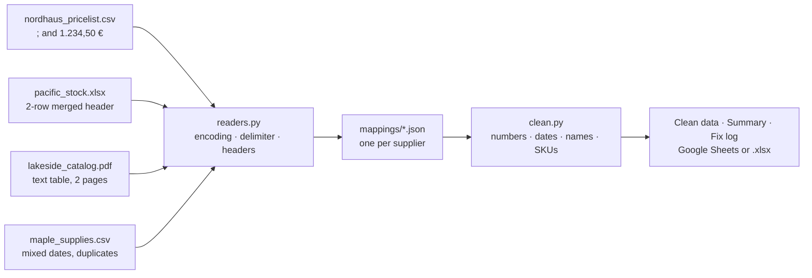

# Messy Data Extractor (Python)

Supplier price and stock lists arrive as CSV, Excel and PDF files, each in its own shape. This script reads them all, fixes the usual problems and writes **one consistent table** to Google Sheets (or a local `.xlsx`) with three tabs: **Clean data**, **Summary** and **Fix log**.

Everything here runs on **fictitious supplier files** generated by `demo/make_demo_files.py`.



## What it fixes

| Problem | Example in the demo files | Result |
| --- | --- | --- |
| Semicolon delimiter, cp1252 encoding | `nordhaus_pricelist.csv` | Detected; the mapping can also force them |
| European decimals and currency text | `1.234,50 €`, `$1,299.00`, `US$ 45.10` | `1234.5`, `1299.0`, `45.1` + a currency column |
| Header in two rows with merged cells | `Item` over `Code`/`Description` | `Item Code`, `Item Description` |
| Text-based PDF table over several pages | `lakeside_catalog.pdf` | One table; the repeated header is dropped |
| Mixed date formats in one column | `02/19/26`, `2026-04-03`, `April 3`, `03.04.2026` | ISO dates; `DMY`/`MDY` comes from the mapping, a missing year from `--year` |
| One column with two values | `M / navy` | `size = M`, `color = Navy` |
| One value split over two columns | `Name` + `Variant` | `product` |
| Messy text and SKUs | `  STAINLESS steel BOTTLE`, ` pc 201 ` | `Stainless Steel Bottle`, `PC-201` |
| The same SKU twice | older and newer row | Newest kept, the other logged |
| Values that can't be read | `call us`, `someday` | Left blank and logged, never silently dropped |

Every change is a row in **Fix log**: file, source row, column, original value, cleaned value and the rule applied.

**Summary** has one row per supplier: products, units in stock, average price, currency, latest update, and price increases/decreases since the previous run (prices are saved to `output/last_prices.json` after each run).

Not supported: scanned PDFs (images). That would need OCR.

## Install

Python 3.10 or newer.

```bash
cd integrations/python/messy-data-extractor
python -m venv .venv
.venv\Scripts\activate          # Windows  (macOS/Linux: source .venv/bin/activate)
pip install -r requirements.txt
```

## Run the demo

```bash
python demo/make_demo_files.py          # writes the 4 fictitious files to demo_data/incoming/
python -m extractor --year 2026         # → output/clean.xlsx
```

### Write to Google Sheets

1. In Google Cloud, create a service account and download its JSON key (*IAM → Service accounts → Keys*). Enable the Google Sheets API for the project.
2. Create a Google Sheet and **share it** with the service account's email (Editor).
3. Run:

```bash
python -m extractor --year 2026 --sheet-id <the ID in the sheet URL> --credentials service-account.json
```

The three tabs are created (or replaced) in that sheet. Keep the JSON key out of Git (`.gitignore` already ignores `service-account*.json`).

## Add a new supplier

Drop a JSON file in `mappings/`. No code changes.

```json
{
  "supplier": "Nordhaus Supply",
  "match": "nordhaus*.csv",
  "format": "csv",
  "decimal": ",",
  "date_order": "DMY",
  "currency": "EUR",
  "columns": {
    "sku": "Art.-Nr.",
    "product": "Bezeichnung",
    "unit_price": "Preis",
    "stock_qty": "Bestand",
    "updated_on": "Datum"
  }
}
```

| Key | Meaning |
| --- | --- |
| `match` | File name pattern (`*` wildcard). The first mapping that matches is used. |
| `format` | `csv`, `xlsx` or `pdf` (default: the file extension). |
| `encoding`, `delimiter` | Optional; detected when left out. |
| `header_rows` | `2` when the header spans two rows (merged cells on top). `skip_rows` skips title lines above it. |
| `decimal` | `","` for `1.234,56`, `"."` for `1,234.56`. |
| `date_order` | `"DMY"` or `"MDY"`, for dates like `03/04/24`. |
| `currency` | Currency code when the file has no currency column. |
| `columns` | Target column → the supplier's header. Targets: `sku`, `product`, `unit_price`, `stock_qty`, `updated_on`, `currency`, `size`, `color`. |
| `split` | `{ "source": "Size / Color", "into": ["size", "color"], "separator": "/" }` |
| `merge` | `{ "product": ["Name", "Variant"] }` |

## Tests

```bash
python -m pytest -q
```

53 tests: every number, date and text rule; each reader (cp1252 + semicolon CSV, UTF-8 CSV, two-row Excel header, two-page PDF); and the whole pipeline on freshly generated demo files, checking that **each kind of fix appears in the log**, duplicates keep the newest row, bad values are logged instead of dropped, price changes are counted against a previous run, and the output has the three tabs.
